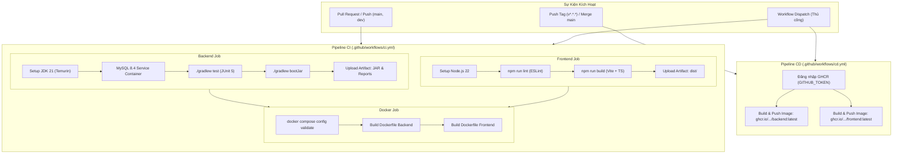

# 🚀 Hướng Dẫn CI/CD — WareFlow (Team 8)

Hệ thống CI/CD của WareFlow được xây dựng bằng **GitHub Actions**, bao gồm 2 pipeline chính:
1. **CI Pipeline (`.github/workflows/ci.yml`)**: Tự động kiểm thử, lint và build khi có push hoặc pull request vào các nhánh `main`, `dev`, `develop`.
2. **CD Pipeline (`.github/workflows/cd.yml`)**: Tự động đóng gói Docker images và xuất bản lên **GitHub Container Registry (GHCR)** khi hợp nhất vào nhánh `main` hoặc tạo Git Release tag (`v*.*.*`).

---

## 🏗️ 1. Kiến Trúc Pipeline



---

## 📋 2. Chi Tiết Các Bước CI (Continuous Integration)

### 🔹 Backend CI (Spring Boot 4.x / Java 21)
- **Môi trường**: Ubuntu Latest.
- **Dịch vụ phụ trợ**: Tự động khởi chạy service container `mysql:8.4` với cơ chế healthcheck.
- **Các bước thực thi**:
  1. Kiểm tra mã nguồn qua `actions/checkout@v4`.
  2. Cài đặt OpenJDK 21 Temurin và kích hoạt cache Gradle (`actions/setup-java@v4`).
  3. Cấp quyền thực thi cho file wrapper (`chmod +x gradlew`).
  4. Biên dịch mã nguồn (`./gradlew compileJava compileTestJava`).
  5. Chạy bộ kiểm thử tự động (`./gradlew test`) kết nối tới container MySQL CI.
  6. Đóng gói file chạy (`./gradlew bootJar -x test`).
  7. Tự động lưu trữ (Artifact):
     - **Báo cáo lỗi kiểm thử** (`test-reports`) nếu có test thất bại.
     - **File jar thực thi** (`wareflow-backend-jar`) khi build thành công.

### 🔹 Frontend CI (React 19 / TypeScript / Vite)
- **Môi trường**: Ubuntu Latest.
- **Các bước thực thi**:
  1. Cài đặt Node.js 22 và kích hoạt cache npm (`actions/setup-node@v4`).
  2. Cài đặt các thư viện sạch với `npm ci`.
  3. Kiểm tra cú pháp và chất lượng mã với `npm run lint`.
  4. Biên dịch TypeScript và đóng gói Vite (`npm run build`).
  5. Lưu trữ bản build tĩnh (`wareflow-frontend-dist`) làm artifact.

### 🔹 Docker Sanity Check
- Kiểm tra tính hợp lệ của cú pháp `docker compose config`.
- Thử nghiệm build thực tế cả 2 `Dockerfile` đa tầng (multi-stage build) để đảm bảo không bị lỗi phân quyền hoặc thiếu tệp khi đóng gói.

---

## 🚢 3. Chi Tiết Các Bước CD (Continuous Delivery)

Khi code được merge vào `main` hoặc tạo release tag:
1. GitHub Actions sử dụng sẵn secret mặc định `${{ secrets.GITHUB_TOKEN }}` (không cần cài đặt thủ công).
2. Xây dựng và gắn tag tự động cho images:
   - `ghcr.io/wallkertan/team8-wareflow/backend:latest`
   - `ghcr.io/wallkertan/team8-wareflow/backend:<sha>`
   - `ghcr.io/wallkertan/team8-wareflow/frontend:latest`
   - `ghcr.io/wallkertan/team8-wareflow/frontend:<sha>`
3. Đẩy (Push) lên GitHub Packages / Container Registry với cơ chế GitHub Actions Cache để tối ưu thời gian build ở các lần tiếp theo.

---

## 💻 4. Hướng Dẫn Triển Khai Trên Máy Chủ / VPS (Deployment)

Sau khi CD pipeline build và push images lên GHCR, bạn có thể triển khai hệ thống trên VPS bằng file [docker-compose.prod.yml](../docker-compose.prod.yml):

### Bước 1: Chuẩn bị trên VPS
Tạo thư mục dự án và sao chép 2 file lên VPS:
- `docker-compose.prod.yml`
- `.env` (chứa các thông tin cấu hình bảo mật như `DB_PASSWORD`, `JWT_SECRET`,...)

### Bước 2: Đăng nhập vào GHCR trên VPS (nếu package để ở chế độ Private)
```bash
echo $CR_PAT | docker login ghcr.io -u <github-username> --password-stdin
```
*(Nếu Package được chuyển sang Public trong phần Settings repo, bạn không cần đăng nhập).*

### Bước 3: Kéo images mới nhất và khởi động
```bash
# Kéo images mới nhất từ GHCR
docker compose -f docker-compose.prod.yml pull

# Khởi chạy toàn bộ hệ thống ở chế độ nền
docker compose -f docker-compose.prod.yml up -d

# Xem log các dịch vụ
docker compose -f docker-compose.prod.yml logs -f
```

---

## 🔍 5. Kiểm Tra Trạng Thái & Khắc Phục Sự Cố

1. **Xem tiến trình CI/CD**:
   - Truy cập vào tab **Actions** trên repository GitHub: `https://github.com/WallkerTan/team8-wareflow/actions`.
   - Mỗi commit/PR sẽ hiển thị dấu tick xanh (Passed) hoặc dấu chéo đỏ (Failed).
2. **Kích hoạt thủ công**:
   - Trong tab **Actions**, chọn workflow **CI Pipeline** hoặc **CD Pipeline** -> nhấn nút **Run workflow**.
